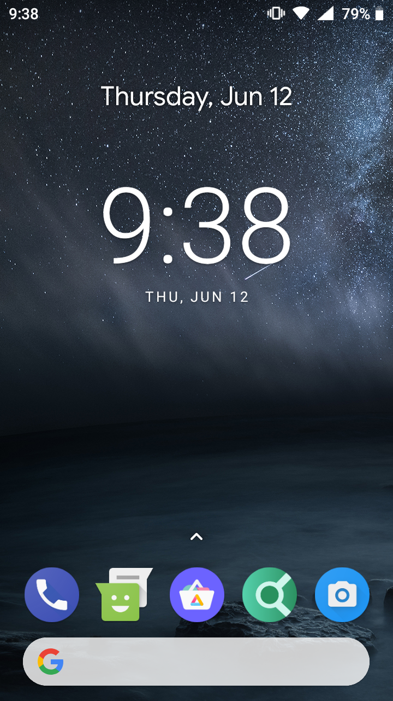
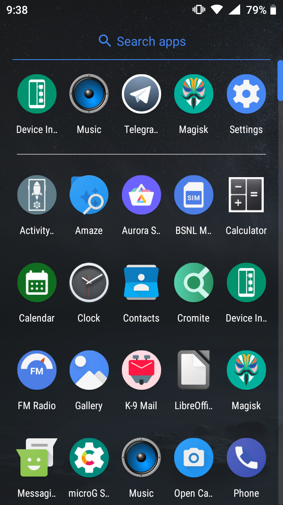

```
 *

 * I am not responsible for bricked devices, dead SD cards,

 * thermonuclear war, or you getting fired because the alarm app failed. Please

 * do some research if you have any concerns about features included in this ROM

 * before flashing it! YOU are choosing to make these modifications, and if

 * you point the finger at me for messing up your device, I will laugh at you.

 *
```


This is a modified stock ROM for Nokia 3 TA-1032 based on firmware 00WW_5_230, with FOSS apps (microG, NewPipe, Fossify, LibreOffice, AOSP, etc) and a lot of features. All bloat/spyware has been removed.

# Features:
1. Lightning-fast experience

2. The ROM is fully debloated and goolag-free, and has only FOSS apps and microG

3. Pre-rooted with latest Magisk

4. All system apps are updated regularly

5. "Evenwell" bloat/spyware removed

6. Dolby atmos included for better sound quality

7. Stock camera (which sent data to Facebook) replaced with Open Camera

8. INSANE Battery life

9. Termux included as a Terminal/shell app

10. Widevine and other DRMs ("digital handcuffs") have been removed

11. A lot of nonfree components and libraries have been removed

12. FOSS App Tubular (fork of NewPipe) included for premium, adfree and surveillance-free YouTube experience. Tubular is archived and no longer maintained, so it was removed from the ROM.

13. LibreOffice included for viewing Office documents

14. A lightweight FOSS PDF Viewer is included

15. `adb root` is supported

16. Secure signature spoofing support for microG

17. MTK Engineering Mode added

18. Since all goolag apps have been removed, FRP and other nonsensical "protection" "features" don't exist. FRP is possibly also a form of DRM.

19. Thermal throttling (anti)feature removed, which was responsible for underclocking the CPU to 1027 MHz during video playback

20. Several WiFi and cellular data tweaks included to increase internet speed and signal strength

21. Modified AOSP Quickstep launcher to allow homescreen rotation

22. Built-in bootloader lock/unlock control without erasing data

23. APK signature verification disabled

24. 180° rotation enabled

25. Basic ad and tracker blocking


# Bugs:
1. Loudspeaker sometimes stops working at lower volumes (workaround: crank up the volume to the highest, then decrease it again)

2. MTK Engineering mode crashes [WIP] (workaround: install Activity Launcher and launch the specific activity of EngineerMode that you need. **NOTE:** most features don't work due to incompatibility with com.android.phone)

3. Location icon sometimes gets stuck in the status bar even after the app has stopped accessing location.

4. Can't send MMS messages as libdrmframework_jni.so is missing (SMS still works fine) [WON'T FIX]


# Installation:
## Main installation process:
### Method 1 (fastboot):

1. Extract the NE1.zip file

2. Reboot to bootloader

3. Type:


```
fastboot flash boot boot.img

fastboot flash system system.img

fastboot -w (erases data; only necessary if flashing for the first time)

fastboot reboot
```


4. Enjoy!

### Method 2 (TWRP):

1. Copy and extract the NE1.zip file to the phone's external SD card

2. Select Install > Install Image in TWRP

3. Navigate to the location of the images and flash them to the respective partitions

4. Format data

5. Reboot and enjoy!

### Method 3 (Locked bootloader):

Yes, this ROM can boot with a locked bootloader!

1. Install mtkclient by (carefully) following the instructions [here](https://github.com/bkerler/mtkclient)

2. Extract the NE1.zip file and copy the images to the mtkclient folder

3. Completely power off the phone and type these mtkclient commands, one by one:


```
mtk e userdata (erases data; only necessary if flashing for the first time)

mtk e cache

mtk w boot boot.img

mtk w system system.img

mtk reset
```


4. Disconnect USB cable and turn on the phone

5. Let the phone turn on, and enjoy!

You can also lock the bootloader after flashing the ROM to get rid of the orange state message and for faster boot times:

1. If you have TWRP installed, flash stock recovery from 00WW_5_230 first. Otherwise, you will get "red state" if you try to boot into recovery, and the only way to turn off the phone would be to drain/disconnect the battery.

2. **Method 1:** Boot to fastboot and type `fastboot flashing lock`. This will erase your data.

3. **Method 2:** Open the built-in "Bootloader Lock Control" app by typing `*#*#96191#*#*` in Dialer. Now tap "Lock bootloader" in the app and reboot. This will NOT erase your data.


**NOTE: If your bootloader is locked, you will not be able to boot the phone if the charger is not connected. You will get the "red state" error. This is due to how the Nokia 3's bootloader works. For the same reason, you also can't boot into recovery or fastboot through button combinations if the phone is running on battery. You can disconnect the charger after the phone starts playing the boot animation with the Nokia logo.**

## Root and first time setup:
1. After booting, wait for about a minute at the setup screen until the toast "Done! Rebooting in 10 seconds...." appears. The phone will then reboot, and you can continue the setup. If the toast does not appear, just continue the setup.

2. After completing setup, you should have the Magisk "stub" app in your launcher. Open it and install the full Magisk app.

3. After Magisk gets installed, you should be on the launcher. Now open Magisk and tap OK on the "Requires additional setup" prompt.

4. The phone will reboot.

5. If you didn't see the toast in step 1, it will appear now. Wait for the phone to reboot, and enjoy the ROM!

## Performance/speed tips:
1. Enable "Disable HW overlays" in developer options (needs to be enabled after every boot)

2. Reduce "Logger buffer sizes" in developer options to 64K

3. Disable "Adaptive battery"

4. Set SELinux to Permissive

<details>
<summary>How to set SELinux to Permissive</summary>
<hr>

Type this in either `adb shell` or Termux:


```
su -c setenforce 0
```


The change is temporary. You need to do this on every boot.
<hr>

</details>


After applying these, you should always have over 1 GB RAM free on the home screen.

# Screenshots



Also managed to get a stable 13 FPS on Minecraft PE with 5 chunks render distance and maximum graphics quality (at 1920x1080 resolution). This may sound silly, but it's actually a huge improvement. Also, the default resolution is 1280x720 for this phone, so with this resolution you should get 20+ FPS at the same settings.


# Download
https://github.com/IsHacker003/NE1_ROM/releases


# Credits (all usernames are from XDA):
1. @IsHacker (for original work) [ME]

2. @Renate (for the Developer Options workaround)

3. @Rstment ^m^ (for helping me fix WebView implementation)

(If you contributed to this ROM but your name isn't listed here, please PM me on XDA or create an issue here. I'll happily add it.)


# Kernel source:
https://github.com/IsHacker003/android_kernel_nokia_heart

This ROM is based on firmware 00WW_5_230. Original firmware (OTA):

https://androidfilehost.com/?fid=10763459528675589392


# ROM Source:
This is the source code of the modifications done by me. To get the full source code of the stock ROM, go to HMD Global's website.

https://github.com/IsHacker003/NE1_misc


# Source code of apps:
## Included apps:
**README:** All apps listed here has been compiled from source by me, instead of just using the prebuilt APKs. I also modified several apps to work with this ROM, and I linked my modified source code where necessary.


1. MicroG: https://github.com/microg/GmsCore

2. Talkback FOSS: https://github.com/talkback-foss-team/talkback-foss

3. Clock: https://github.com/qw123wh/Aospdeskclock

4. LibreOffice: https://github.com/LibreOffice/core/tree/master/android

5. PDF Viewer: https://github.com/IsHacker003/pdf_viewer_system

6. Termux: https://github.com/termux/termux-app

7. Aurora Store: https://github.com/IsHacker003/AuroraStore/archive/refs/tags/v4.8.1.zip

8. Cromite: https://github.com/uazo/cromite

9. K-9 Mail: https://github.com/thunderbird/thunderbird-android

10. Magisk: https://github.com/topjohnwu/Magisk

11. Amaze File Manager: https://github.com/TeamAmaze/AmazeFileManager

12. AOSP Music: https://github.com/IsHacker003/AOSP-Music

13. Open Camera: https://sourceforge.net/p/opencamera/code/ci/master/tree/

14. PicoTTS: https://github.com/IsHacker003/picoTTS

15. Launcher3: https://android.googlesource.com/platform/packages/apps/Launcher3

16. Tubular: https://github.com/polymorphicshade/Tubular

17. MicroG GSFProxy: https://github.com/microg/GsfProxy

18. Fossify Calendar: https://github.com/FossifyOrg/Calendar

19. F-Droid: https://github.com/f-droid/fdroidclient

## Other Important/Suggested apps and components:
1. Activity Launcher: https://github.com/butzist/ActivityLauncher

2. Haystack (signature spoofing patches): https://github.com/Lanchon/haystack
